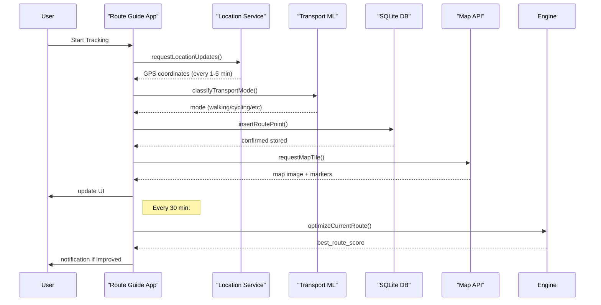

# Route Guide - System Architecture

## 1. High-Level Architecture

```mermaid
graph TD
    subgraph Device [User Device]
        UI [React Native / Swift / Kotlin UI Layer]
        Locator [CoreLocation / FusedLocationProvider]
        Motion [CoreMotion / ActivityRecognition]
        Storage [SQLite / Realm Local DB]
        ML [TensorFlow Lite Transport Model]
        Ads [Google AdMob SDK]
    end

    subgraph Cloud [Optional Cloud]
        Firebase [Firestore / Authentication]
        Sync [Background Sync Service]
        Analytics [Google Analytics]
    end

    subgraph APIs [External Services]
        Maps [Google Maps API / Mapbox]
        AirQuality [OpenWeather Air Pollution]
        Places [Google Places API]
        Push [Firebase Cloud Messaging]
    end

    UI -->|Location Data| Locator
    UI -->|Motion Data| Motion
    Locator -->|Points| Storage
    Motion -->|Mode| ML
    Storage -->|Routes| UI
    UI -->|Ad Requests| Ads
    UI -->|Map Tiles| Maps
    UI -->|Air Quality Data| AirQuality
    UI -->|Places Search| Places
    UI -->|Sync Trigger| Sync
    Sync -->|Push Notifications| Push
end
```

## 2. Core Components

### 2.1 Location Tracking Layer
- iOS: CLLocationManager with continuousUpdating or significantLocationChanges
- Android: FusedLocationProviderClient with PRIORITY_BALANCED_POWER_ACCURACY
- Exponential backoff for location requests

### 2.2 Transport Mode Classification
- On-device ML: TensorFlow Lite model (~200KB, 90%+ accuracy)
- Input: GPS speed, accelerometer X/Y/Z, gyroscope, altitude, time between points
- Updates: Every 5-10 minutes or on significant movement

### 2.3 Route Storage Layer
- SQLite with spatial extensions (GIS)
- Schema: route_id, timestamp, latitude, longitude, altitude, transport_mode, air_quality_index, noise_level, pollution_score

### 2.4 Route Optimization Engine
- Weighted sum scoring algorithm
- Factors: Air quality 30%, Noise 25%, Distance 20%, Exercise 15%, Traffic 10%
- Output: Route score (0-100), recommended route ID
- Calculation time: < 2 seconds on device

## 3. Data Flow



## 4. Offline Strategy

- Local-first design: All tracking data stored device-side
- Cache: Last 30 days of routes locally
- Map tiles cached based on travel patterns
- Transport model always on-device
- Sync when online: Firebase Firestore auto-sync, timestamp-based conflict resolution

## 5. Security & Privacy

- Data minimization: Only collect essential fields
- Encryption: SQLite database encrypted with SQLCipher
- Background tracking: Persistent notification on Android
- User consent: First-launch permissions screen
- Data export: User-initiated CSV/JSON export
- Delete all: Settings → Clear all route data

## 6. Scalability

- Per-user data: ~5MB per active user (30 days)
- No shared database bottlenecks: Local-first architecture
- Optional cloud sync: Firebase scales to 10K+ users easily
- Background battery impact: < 5%/day measured on current devices
