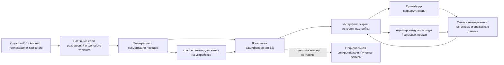

# Route Guide — продуктово-техническое ТЗ

**Версия:** 1.0  
**Статус:** проектное ТЗ для оценки и подготовки MVP; не является подтверждением доступности данных поставщиков в каждом городе.  
**Назначение:** зафиксировать поведение продукта, ограничения платформ, источники данных, требования к приватности, критерии приемки и недостающие решения.

## 1. Вывод по текущему проекту

**Разрабатывать можно, но текущих документов недостаточно, чтобы безопасно начинать реализацию без уточнения платформы, географии запуска и поставщиков данных.** Сейчас в репозитории есть продуктовые идеи, перечень экранов, черновая архитектура, требования и референсы, но нет исходного кода, утвержденного стека, проверенной доступности данных о шуме/загрязнении, модели приватности, бюджета API и критериев качества.

Главное уточнение концепции: приложение может записывать посещения и перемещения в фоне при выданных разрешениях и соблюдении требований ОС, но нельзя обещать гарантированную непрерывную запись на всех устройствах, при выгрузке приложения, отключенной геолокации, ограничениях батареи или отказе пользователя. Начинать запрос разрешения «Всегда» сразу при первом запуске не следует: сначала объяснить пользу и запросить доступ поэтапно.

Ниже это ТЗ дополняет существующие [RouteGuide_TZ.md](./RouteGuide_TZ.md), [Features.md](./Features.md), [Functionality_Analysis.md](./Functionality_Analysis.md), [Screen_Guides.md](./Screen_Guides.md), [Technical_Requirements.md](./Technical_Requirements.md), [Architecture.md](./Architecture.md), [Google_Ads_Integration.md](./Google_Ads_Integration.md) и [Tech_Lead_Perspective.md](./Tech_Lead_Perspective.md). В качестве визуальных референсов использованы изображения из [docs/design/references/](./docs/design/references/).

## 2. Продукт

### 2.1 Цель

Route Guide приватно ведет историю перемещений пользователя и предлагает альтернативные пешие/велосипедные маршруты, которые могут быть чище, тише или приятнее, показывая понятный компромисс по времени и расстоянию.

### 2.2 Основная аудитория и сценарий

- Жители городов, которые регулярно ходят пешком, ездят на велосипеде или общественном транспорте.
- Пользователь разрешает запись местоположения, видит сохраненную историю и может отключить запись или удалить отдельные данные.
- При планировании маршрута сравнивает обычный вариант и альтернативу: время, расстояние, качество исходных данных, ожидаемые преимущества и причины выбора.

### 2.3 Принципы продукта

1. **Приватность по умолчанию:** история хранится локально; синхронизация — только отдельная включаемая функция с ясным согласием.
2. **Честность данных:** оценка воздуха/шума содержит источник, время измерения или расчета, пространственную точность и пометку о недоступных/устаревших данных.
3. **Объяснимые рекомендации:** «на 4 минуты дольше, расчетное загрязнение ниже на 18%, данные обновлены в 10:20» вместо безусловного «здоровый маршрут».
4. **Контроль пользователя:** пауза, ручное исправление типа транспорта, редактирование мест, экспорт и удаление данных.
5. **Нет медицинских обещаний:** это навигационная оценка экспозиции, а не измерение индивидуальной дозы или медицинская рекомендация.

## 3. Объем работ

### 3.1 MVP

- iOS и Android либо одна выбранная платформа для пилота — решение требуется утвердить.
- Онбординг, краткое объяснение фоновой геолокации, выбор хранения и управления данными.
- Запись координат в фоне с обработкой разрешений, слабого GPS, отсутствия сети и пауз.
- Автоматическая классификация поддерживаемых режимов движения с оценкой уверенности; ручное исправление.
- Локальная история: список поездок/прогулок, карта трека, детали, фильтр по дате и типу перемещения.
- Запрос маршрута между двумя точками и сравнение базового и альтернативного маршрутов.
- Первичная оптимизация **пешеходных** маршрутов по качеству данных о воздухе и прокси тихих/зеленых улиц; транспортные режимы — отдельные профили.
- Офлайн-сохранение маршрутов и истории, индикатор отсутствия актуальных внешних данных.
- Настройки записи, конфиденциальности, разрешений, экспорта и удаления.
- Аналитика только после отдельного решения по приватности и согласию; рекламная монетизация не является обязательной частью MVP.

### 3.2 Не включать в первый релиз без отдельного подтверждения

- Гарантию постоянного фонового отслеживания или конкретного процента расхода батареи.
- Точные исторические концентрации загрязнителей на каждой точке маршрута, если поставщик этого не лицензирует.
- Реальное измерение шума с телефона при выключенном/закрытом приложении.
- Автоматическое и бесспорное определение дома/работы без согласия пользователя.
- Социальные функции, пользовательскую карту загрязнения, платную подписку, рекламу, калории и интеграцию со здоровьем.
- Обещание «на 20% чище» до появления проверенного источника, методики расчета и тестовых данных.

## 4. Пользовательские сценарии и требования

### 4.1 Первичный запуск и разрешения

1. Онбординг объясняет, что собирается, зачем нужна фоновая геолокация, где хранится история и как ее удалить.
2. Пользователь может начать без учетной записи и отказаться от фоновой записи.
3. Разрешение на геолокацию запрашивается в контексте понятного действия; фоновый доступ запрашивается только после объяснения ценности функции и согласно текущим правилам iOS/Android.
4. Если разрешение запрещено/отозвано, приложение показывает состояние и путь в настройки, но не продолжает скрытую запись.
5. В любой момент доступна заметная пауза/возобновление записи.

### 4.2 Запись и определение поездок

- При наличии разрешений приложение получает системные события местоположения/активности, фильтрует некорректные точки и сохраняет точки локально.
- Записываются как минимум: время, координаты, точность, высота (если доступна), источник координат, статус записи и версия классификатора.
- Точки с плохой точностью не должны создавать ложные петли или резкие скачки; такие участки помечаются неопределенными, а не маскируются.
- По остановке/переходу между активностями сегментируются поездки. Пользователь может объединить, разделить, переименовать или удалить поездку.
- Транспорт: пешком, велосипед, автомобиль, общественный транспорт, поезд/метро и мотоцикл — только если классификатор может надежно различить их. Иначе показывается «не определено»/«транспорт» и доступно ручное исправление.
- Результат модели включает уверенность. Изменение режима требует подтверждения последовательностью наблюдений, чтобы не переключать иконку на каждом шумном GPS-сэмпле.
- Классификация выполняется на устройстве, если это достижимо на выбранном стеке; серверная передача сенсорных данных не нужна для базового сценария.

### 4.3 История и карточка поездки

- История группируется по дню и показывает время, длительность, расстояние, предполагаемые режимы и состояние качества данных.
- Экран поездки показывает трек на карте, начало/конец, сегменты режима, шкалу воспроизведения и сводку.
- Воздействие воздуха/шума показывается только там, где есть данные; значение снабжается единицей, источником, возрастом данных и пометкой «оценка».
- «Плохой/хороший маршрут» — сравнение альтернатив по факторам, а не оценка поведения человека. Не кодировать качество только цветом.
- Пользователь может исправить режим, удалить точку/поездку и сообщить об ошибке классификации.

### 4.4 Поиск и рекомендация маршрута

- Вход: точка A, точка B, вид перемещения, предпочтения пользователя, текущее время/дата и доступность источников данных.
- Сначала запрашивается допустимый маршрут у провайдера маршрутизации; затем альтернативы оцениваются по сегментам и выбранному профилю.
- Возвращаются несколько вариантов, минимум: быстрый/короткий (если провайдер предоставляет) и рекомендованный. У каждого отображаются время, расстояние, разница со сравнительным вариантом, факторы, свежесть данных и неопределенность.
- Пеший бонус «не более +5 минут» — **настраиваемое правило ранжирования, не жесткая гарантия**. Альтернатива может выиграть только если прирост времени укладывается в настройку и улучшение подтверждено доступными данными; при неизвестных данных приложение не выдает уверенный экологический вывод.
- Для разных факторов применяются нормализация и пользовательские ограничения. Веса 30/25/20/15/10 из черновика — стартовая гипотеза, требующая калибровки и тестирования, а не доказанная модель.
- Показать «почему выбран»: например, меньше крупных дорог/больше зеленых улиц, ожидаемая разница времени и источник оценок.
- Если воздух или шум недоступны/устарели, деградировать явно: предложить маршрут по дорожной сети и озеленению, отметить отсутствующие факторы, не подставлять нули.

## 5. Экраны и визуальные референсы

| Экран/состояние | Референс и назначение | Требования |
|---|---|---|
| История / дневная хронология | [route history.jpeg](./docs/design/references/route%20history.jpeg) | Карта и хронологическая лента событий/отрезков; дата, время, место и транспорт; не копировать интерфейс Google один-в-один. |
| Карта трека | [view2.jpeg](./docs/design/references/view2.jpeg) | Полноэкранная карта, ясный старт/финиш, сегменты, легенда и управление воспроизведением. |
| Неблагоприятный вариант | [view1bad.jpg](./docs/design/references/view1bad.jpg) | Красный путь как визуальное сравнение высоких оценок воздействия; доступные подписи и легенда обязательны. |
| Предпочтительный вариант | [view3good.jpg](./docs/design/references/view3good.jpg) | Зеленый путь и понятные преимущества; не утверждать факт чистого воздуха без измерений/модели. |

Дополнительные состояния: пустая история, запись остановлена/идет, разрешение запрещено, слабый GPS, нет сети, данные о среде отсутствуют или устарели, маршрут недоступен, ошибка синхронизации, подтверждение удаления, экспорт.

### 5.1 Навигация приложения

1. **Сегодня:** состояние записи, краткая дневная сводка, переход к карте и истории.
2. **История:** календарь/список поездок и фильтры.
3. **Маршрут:** A/B, выбор транспорта и предпочтений, сравнение вариантов, запуск внешней навигации или пошагового ведения (если реализуется).
4. **Детали поездки:** карта, хронология, сегменты, оценки и источники.
5. **Настройки и приватность:** запись, уведомления, разрешения, экспорт, синхронизация, удаление, политика конфиденциальности.

### 5.2 Визуальная система и доступность

- Направление: спокойная картографическая нейтральная основа, зеленый/бирюзовый для лучшего сценария, красный/янтарный для повышенного воздействия, сдержанные серые слои карты.
- Цвет никогда не единственный носитель смысла: подпись, иконка, форма/штрих маршрута и легенда обязательны.
- Контраст WCAG AA для текста/контролов; масштабирование системного текста; VoiceOver/TalkBack; крупные touch targets; режим уменьшения анимации.
- Все иконки в [docs/design/icons/](./docs/design/icons/), исходник — SVG-спрайт и README по идентификаторам.
- Стиль иконок: единый контур, округлые соединения, масштабируемая геометрия; цвет/размер назначает приложение, а не SVG.

## 6. Рекомендуемая архитектура

Для кроссплатформенной реализации предпочтителен Flutter или React Native **только при наличии проверенных нативных модулей** фоновой геолокации, активности, локального хранилища и карт для целевых версий ОС. Фоновая запись и обработка разрешений остаются платформенно-специфичными; WebView не является приемлемым fallback для критической геолокации. Если надежность фоновой работы важнее единого UI-кода — рассмотреть Swift и Kotlin.

### 6.1 Модель данных (минимум)

- `Trip`: идентификатор, начало/конец, источник и статус сегментации, расстояние/длительность, пользовательская метка.
- `TrackPoint`: поездка, timestamp UTC, широта/долгота, accuracy, высота?, источник, флаги качества.
- `ModeSegment`: интервал времени/точек, категория транспорта, уверенность классификатора, ручное подтверждение.
- `EnvironmentalSample`: геопривязка/сегмент, показатель и единицы, источник, время наблюдения/моделирования, радиус/разрешение, признак прогноза/прокси.
- `RouteCandidate`: геометрия, профиль, время/длина, версия расчета, факторы оценки и причина рекомендаций.
- `Consent/Settings`: разрешения и согласия отдельно, версия текста/политики, timestamp, пользовательские предпочтения.

Не хранить адреса дома/работы как обязательное поле. Точность координат, жизненный цикл, экспорт и удаление должны быть определены до запуска.

## 7. Подключаемые системы и сервисы

Слово «обязательно» ниже означает обязательный класс возможностей для конкретной функции, но не конкретного вендора. Все поставщики сначала проверяются на географическое покрытие, тарифы, лимиты, лицензирование, условия кэширования и работу с персональными данными.

| Система | Назначение | MVP | Варианты / решения и ограничения |
|---|---|---:|---|
| Системные службы iOS/Android | Геолокация в фоне, активность/сенсоры, уведомление/индикатор записи | Да | Core Location и Core Motion на iOS; Fused Location Provider и Activity Recognition/foreground service на Android. Требуются разрешения, объяснение пользователю, проверка правил магазинов. |
| Поставщик карт и маршрутизации | Отрисовка карты, пешеходная/велосипедная сеть, альтернативные пути, ETA | Да | Выбрать один стек: Google Maps Platform; Mapbox; OSM-совместимый стек с GraphHopper/Valhalla/OSRM и выбранным хостингом. Ключи ограничивать по bundle ID/package/signature/API; проверить лицензии карт и кэширование. Карта SDK и Directions API могут тарифицироваться раздельно. |
| Геокодер/поиск мест | Поиск адреса и выбор точки A/B | Для планировщика | Google Places/Geocoding, Mapbox Search либо провайдер выбранной карты. Не запрашивать/хранить адреса сверх необходимого. |
| Воздух | Сопоставление сегментов маршрута с концентрациями/индексом | Для «чище» рекомендаций | Сначала выбрать страну/город и проверить покрытие. Кандидаты: OpenWeather Air Pollution; Open-Meteo Air Quality; официальные/региональные источники. Модельная сетка/прогноз не равны измерению у тротуара; архив, частота, единицы и коммерческие права зависят от продукта/тарифа. |
| Шум | Карта шума либо дорожный прокси | Ограниченный MVP | Реального общегородского live API может не быть. Возможны официальные карты стратегического шума (где опубликованы), дорожная классификация/интенсивность как прокси. OpenStreetMap не является измерением dB. Калибровка микрофона не заявляется в MVP. |
| Дорожная сеть/озеленение | Избегание магистралей и предпочтение парков/велодорожек | Желательно | OSM теги, карта маршрутизации/POI или соответствующая карта выбранного поставщика. Покрытие и лицензия требуют проверки. |
| Учетная запись/синхронизация/сервер | Перенос/резервное копирование, серверная агрегация при необходимости | Нет, отдельно | Firebase, Supabase или собственный API — только после выбора региона размещения, модели доступа, шифрования и удаления. Отсутствие серверного аккаунта должно оставаться полноценным сценарием MVP. |
| Crash reporting / продуктовая аналитика | Стабильность, воронка и качество классификатора | Опционально | Firebase Crashlytics/Sentry и аналитика с минимальным сбором; не отправлять точный трек/домашний адрес; включать только после утверждения политики, согласия и сроков хранения. |
| Уведомления | Напоминания и статусы записи | Опционально | Локальные уведомления достаточны для MVP; push (FCM/APNs) требует backend и не должен быть условием записи. |
| Реклама и платежи | Монетизация | Не MVP | AdMob/StoreKit/Google Play Billing требуют отдельного согласия/раскрытия, соблюдения privacy policy и правил магазина. Не показывать рекламу во время записи/навигации; исключить передачу точной геолокации рекламной сети. |
| Здоровье/фитнес | Шаги/активные калории | Не MVP | HealthKit/Google Health Connect — отдельный opt-in и отдельное обоснование. Не требуются для основной ценности продукта. |

**Предварительный минимальный набор для пилота:** нативные службы ОС, один провайдер карты + пешей маршрутизации + геокодинга и один выбранный источник воздуха с проверенным покрытием пилотного города. Шум сначала показывать как явно маркированный прокси или исключить из ранжирования. Аккаунт, облако, реклама и health API не обязательны.

### 7.1 Подготовка доступов и ключей

- Создать проекты поставщиков, настроить биллинг/лимиты/уведомления, тестовые и production credentials.
- Не хранить секреты API в публичном репозитории или мобильном клиенте, если API требует секретного ключа; использовать ограничения ключа и серверный прокси, когда это предусмотрено моделью поставщика.
- Разнести dev/staging/prod, ограничить ключи по приложению и разрешенным API, настроить ротацию и лимиты расходов.
- Зафиксировать тариф, квоты, кредитный лимит и поведение приложения при отказе/исчерпании квоты.
- Проверить политики Google Play/App Store для фоновой локации, рекламных SDK, удаления данных и деклараций privacy.

## 8. Безопасность, приватность и соответствие требованиям

- До разработки определить рынки запуска, применимые нормы обработки персональных данных, юридическое лицо/оператора, срок хранения и контакты для запросов.
- Фоновая история перемещений — высокочувствительная информация. Собирать минимум, хранить локально зашифрованно, не включать координаты в обычные логи, crash reports, аналитику, рекламные запросы и скриншоты поддержки.
- TLS для сетевых запросов; секреты вне репозитория; защита ключей шифрования через Keychain/Keystore; проверка модели резервных копий и удаления.
- Экспорт и удаление должны объяснять, какие копии/синхронизированные устройства затронуты и когда удаление завершено.
- Синхронизация требует аутентификации, правил доступа к данным конкретного пользователя, защиты от повторного воспроизведения/подмены и сценария удаления аккаунта.
- Конкретные обещания «всегда», «не более X% батареи», «90% точности», «20% чище» не выпускать до измерений на репрезентативных устройствах, городах и сценариях.
- Реклама не должна профилировать пользователя по маршрутам; согласие на персонализацию отдельно от согласия на геолокацию.

## 9. Надежность и нефункциональные требования

- Запись сначала сохраняется локально; сетевой сбой не должен терять принятые точки.
- Сырые точки и качество должны быть различимы: пропущенный сегмент нельзя показывать как непрерывную линию без пояснения.
- Время сохраняется в UTC и отображается в локальном часовом поясе; смена часового пояса/DST не должна менять порядок событий.
- Ошибки разрешений, GPS, API, БД и синхронизации отображаются понятным состоянием; запрещены нулевые значения по умолчанию, выдаваемые за измерение.
- Проверить задержку появления режима, точность трека, расход батареи и стабильность фонового режима на реальных устройствах. Численные цели устанавливать после baseline-тестов, не принимать текущие цифры из черновиков за измеренные.
- Не удалять историю автоматически через 90 дней без явного согласия/настройки.
- Offline: просмотр существующей истории, управление записью и сохранение точек; новые маршруты с актуальными данными могут быть недоступны, об этом сообщается явно.

## 10. Проверяемые критерии приемки MVP

1. Пользователь может использовать приложение без аккаунта и самостоятельно приостановить/возобновить запись.
2. При запрете/отзыве разрешения запись реально останавливается; интерфейс сообщает об этом, а системные настройки доступны по ссылке.
3. В тесте с блокировкой экрана и временной потерей сети точки, которые доставила ОС, сохранены локально и отображены в правильном временном порядке; в тестовом отчете явно фиксируются участки, которые платформа не доставила.
4. Пользователь может открыть список поездок, карту поездки, изменить тип режима, удалить поездку и удалить всю локальную историю.
5. Альтернативный маршрут сравнивается с допустимым базовым вариантом по времени/расстоянию; при пропуске environmental API данные помечены недоступными, рекомендация не утверждает, что путь чище/тише.
6. Для каждого показанного показателя среды можно увидеть единицы, источник и время/актуальность данных либо явное предупреждение об оценке.
7. Ручные тесты на маленьком экране, увеличенном системном тексте, VoiceOver/TalkBack и различении вариантов без цвета проходят без критических препятствий.
8. Сетевой/провайдерский сбой, ограничение API, отказ БД или низкая точность GPS не создают успешный экран с фиктивными данными.
9. Проверено удаление координат из диагностических логов и рекламной/аналитической телеметрии.
10. Расход батареи и качество классификации публикуются как результат измерений с указанием модели телефона, ОС, длительности и условий — не как заранее гарантированная константа.

## 11. План разработки

1. **Discovery / proof of feasibility:** выбрать платформы и пилотный город; проверить разрешения фоновой записи, SDK и покрытие API; прототипировать реальный маршрут; согласовать приватность и бюджет.
2. **Основа:** репозиторий приложения, дизайн-система, онбординг/согласия, хранилище, разрешения и ручное управление записью.
3. **Трекинг:** локальная запись, фильтрация качества, сегментация, ручное исправление, тестирование батареи и lifecycle.
4. **История:** карта, хронология, фильтры, воспроизведение и доступность.
5. **Навигация/экологическая оценка:** адаптеры маршрутизации и среды, нормализация, объяснимое сравнение, тестовые сценарии и fail-safe для отсутствующих данных.
6. **Пилот:** приватность, реальные устройства/города, точность, API-затраты, UX, политика магазинов; реклама и облачная синхронизация только как отдельные решения.

Существующие оценки «12 месяцев» и «90% точности/<5% батареи» не являются подтвержденным планом или результатами измерения. Перепланировать после proof of feasibility и определения размера команды.

## 12. Открытые решения перед началом разработки

1. Платформа первого релиза: iOS + Android одновременно или один пилот; нативная разработка либо Flutter/React Native.
2. Первый рынок/город и страны, в которых допустим сбор и обработка геолокации.
3. Что означает «всегда»: фоновая запись по явному согласию или пользователь вручную включает каждую поездку.
4. Поставщик карт/маршрутов и приемлемый месячный бюджет/лимит запросов.
5. Поставщик воздуха и способ отображения прогноза против измерения; доступность архива.
6. Уровень функции шума: исключить на MVP, показать дорожный прокси или подключить проверенную официальную карту.
7. Нужны ли учетная запись/облачная синхронизация при первом релизе.
8. Монетизация и аналитика: оставить за рамками MVP или отдельно спроектировать с согласиями.
9. Срок хранения точных координат, резервное копирование, экспорт и удаление синхронизированных копий.
10. Приоритеты маршрута по умолчанию и подтверждение правила «до +5 минут» / требуемого улучшения.

## 13. Материалы проекта

- [История маршрута — route history.jpeg](./docs/design/references/route%20history.jpeg)
- [Неблагоприятный маршрут — view1bad.jpg](./docs/design/references/view1bad.jpg)
- [Карта маршрута — view2.jpeg](./docs/design/references/view2.jpeg)
- [Предпочтительный маршрут — view3good.jpg](./docs/design/references/view3good.jpg)
- [SVG-иконки Route Guide](./docs/design/icons/README.md)
