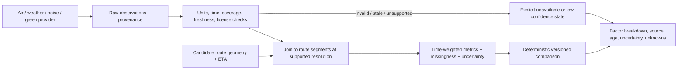

# Environmental Intelligence and Exposure Model

## What the App Actually Reads

`src/services/cityConditions.ts` calls Open-Meteo Air Quality and Forecast endpoints in parallel. Coordinates are rounded to one decimal place before requests; the resulting area is roughly 11 km in latitude and varies in longitude with latitude. The air response reads hourly `pm2_5` near the current UTC hour. The weather response reads current temperature, precipitation, wind, weather code, precipitation probability and cloud cover.

Responses have a process-memory cache keyed by rounded coordinate with an approximate 30-minute freshness window and a maximum of 12 entries. Partial failures can reuse cached fields and mark them stale; if both requests fail with no cache, the service throws. The home screen displays these values as area-level model output. Weather arrows/sun direction are map overlays, not route cost inputs.

No PM10, NO2, O3, SO2, CO, AQI, traffic, acoustic measurement, street-specific samples, vegetation raster or source-specific industrial risk is currently stored or joined to route geometry. Route detail explicitly marks noise and PM2.5 unavailable. The route ranker does not use city conditions.

## Data Meaning and Limits

- A pollutant concentration has pollutant, unit, place/grid support, averaging period, model/measurement status, valid time and provider. Without those, a number is not comparable.
- AQI is a reporting transform, not a pollutant concentration. Scale, averaging window and health breakpoints differ by jurisdiction; a single “AQI” value is unsafe to compare across sources without the scale and method.
- CAMS and Open-Meteo products are gridded/modelled outputs, not curbside monitors. Spatial interpolation can communicate the model cell at a route but cannot create street-level information.
- Forecast valid time is not the same as retrieval time. Store both. A current weather response is not a historical condition at the time of a past trip.
- Wind direction describes where the wind comes from; `getWindTravelBearing` reverses it for the map arrow. Wind alone is insufficient to infer street-level pollutant concentration without emissions, terrain, stability and dispersion modeling.
- Temperature, humidity and precipitation can affect comfort and dispersion, but should not be assigned arbitrary pollution weights. Explain whether each factor affects route comfort or environmental exposure.
- OSM road/land-use/park tags are contextual proxies. They do not measure traffic counts, dB, PM or canopy density.

## Noise and Green Space

Strategic noise maps (for example EU Environmental Noise Directive datasets) expose modelled/averaged metrics such as Lden/Lnight for covered sources and reporting areas. They are periodic, geographically bounded and not a live sound level at the pedestrian's ear. Decibels are logarithmic; do not take a plain arithmetic mean of dB values. Exposure aggregation requires an energy-domain calculation and an explicit time interval.

For a pilot, label road class/proximity as a “road-traffic proxy,” not “noise in dB.” Prefer official noise-map data where coverage, date, method and reuse rights are documented. Do not claim the phone microphone measured background noise unless an explicit foreground measurement workflow, calibration, consent and validity analysis exist.

OSM parks/woods/green-area polygons and remote-sensing canopy products can support “route passes near/through mapped green space” with provider/date/resolution labels. A park boundary is not proof of tree canopy, air purification or a measured health benefit.

## Provenance Contract for Future Data

Each value should carry at minimum: `metric`, `value`, `unit`, `geometry/support`, `source`, `retrievedAt`, `validFrom/validTo`, `observedAt` or forecast status, `spatialResolution`, `method/modelVersion`, `quality/uncertainty`, `license` and optional attribution. Preserve original data and derived values separately. Keep source-specific values; do not merge unlike scales by averaging.

## Deterministic Exposure Calculation: Proposal

First sample route geometry into network-aligned segments. For each segment, attach environmental data only when its temporal and spatial support is valid. Estimate segment travel time from a provider ETA or a declared speed assumption. An exposure proxy can be time-weighted concentration:

`E_proxy = sum(C_i * dt_i)`

where `C_i` is an explicitly identified concentration estimate and `dt_i` is segment residence time. This is not a personal inhaled dose: actual dose would require breathing rate, route/time alignment, microenvironment and sensor/model error. Use distinct named metrics for concentration, time-weighted exposure proxy and any normalized score.

For ranking:

1. Enforce route validity and access constraints first.
2. Normalize only within an explicitly documented metric/population and preserve units.
3. Keep time/distance and environmental factors as a breakdown; record score-model version and weights.
4. Represent missing, stale and low-resolution values as unknown/low-confidence, not as zero or “clean.”
5. Prefer Pareto comparison or a user-visible configurable tradeoff; do not hard-code the early documents' unvalidated 30/25/20/15/10 weights or five-minute bonus as scientific truth.
6. Withhold an environmental recommendation unless improvement is larger than defensible uncertainty and data resolution; otherwise present route choices without a clean/quiet label.

## Data Source Strategy

- **Current prototype:** Open-Meteo for approximate PM2.5 and current weather at rounded coordinates. Keep the existing disclaimer and never use this to rank street routes.
- **Potential broader air coverage:** Copernicus CAMS and official national/regional monitoring services. Assess coverage, resolution, archive, authentication, rate limits and licenses per launch market.
- **Noise:** official strategic noise maps where available; otherwise clearly named road-class/traffic proxies. Live traffic/noise is not currently connected.
- **Green space:** OSM for mapped parks/woods and a suitable open canopy/land-cover product if a pilot requires it.
- **Industrial context:** official emissions/industrial facility registries or validated open datasets; distance to an industrial polygon alone is not measured exposure.

See [external sources](./EXTERNAL_DATA_SOURCES.md) and [target roadmap](./TARGET_ARCHITECTURE_AND_ROADMAP.md).
