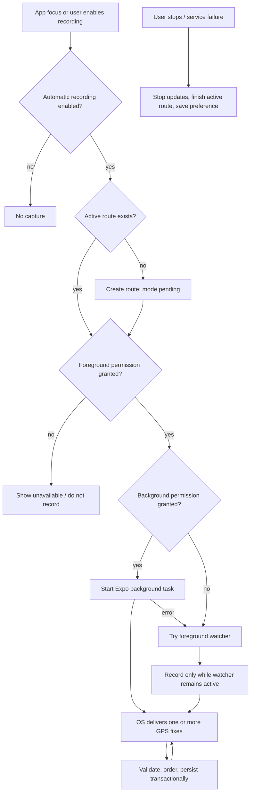
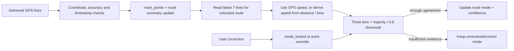
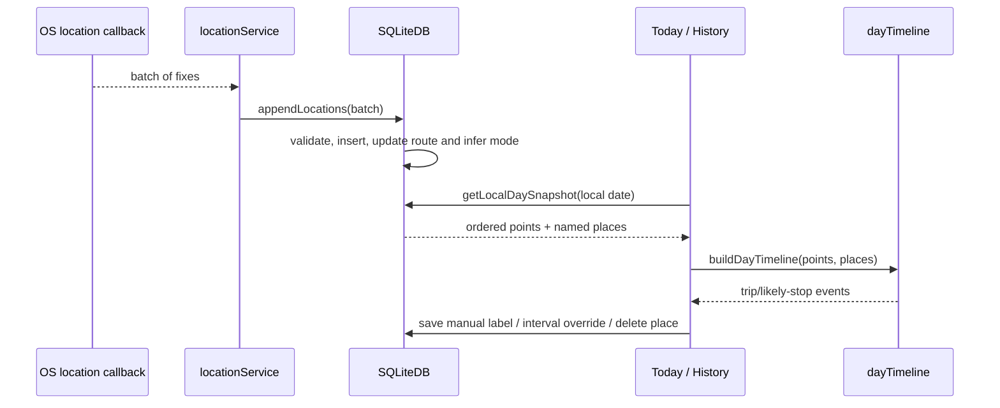

# GPS, History and Storage

## GPS Capture Lifecycle

`src/app/_layout.tsx` imports `locationService` during root module initialization so `TaskManager.defineTask` can register the named task before it is started. Onboarding stores a local profile and asks for foreground location. The recording preference defaults to enabled because `SQLiteDB.isAutomaticRecordingEnabled()` returns true unless the stored value is exactly `false`.

`ensureAutomaticRecording()` reads that preference, creates/reuses an active route, then attempts background capture if background permission is granted. If it cannot start the native task, it falls back to `watchPositionAsync`; that path only exists while the JS app is foregrounded. Settings can request background access separately. Background capture cannot promise delivery after OS restrictions, force-stop, permission revocation, power management or loss of location signal.

The current request uses high accuracy, zero distance threshold, ~30 s interval, no deferred updates and disables automatic pausing. These are requested values, not guaranteed callback cadence or a measured battery profile. The Android notification is configured as a foreground service notification; Android notification permission is separate on newer OS versions.

## Point Validation and Derived Metrics

`SQLiteDB.appendLocations()` sorts each callback batch by timestamp, discards non-finite/out-of-range coordinates, invalid accuracy and timestamps not newer than the latest stored point. Missing accuracy is represented as 1,000 m, while low-accuracy fixes are retained for history but do not contribute to movement distance. Distance increments only when both adjacent accuracy values are at most 100 m, elapsed time is positive and at most 10 minutes, and implied speed is at most 70 m/s. This prevents some spikes; it is not a full map-matching or GPS-noise filter.

`buildDayMetrics()` and `buildDayTimeline()` use local calendar days. Movement gaps above 10 minutes are excluded from trip distance/time; segment distances above 5 km are ignored. Moving duration is capped to 120 seconds per accepted point pair. These are explicit heuristics, not sensor-derived truth.

## Transport Inference

`transportClassifier.ts` considers the last seven reliable speed observations, requires at least three, and uses thresholds: below 0.7 m/s = no mode; below 2.8 = walking; below 8.3 = cycling; otherwise “motorized transport.” It returns the modal class only when at least three observations agree and confidence is at least 0.6. It cannot distinguish car, bus, train or motorcycle and does not use accelerometer, gyroscope, transit schedules or an ML model.

`database.ts` applies the classifier only when the active route is not manually locked. Manual route correction locks the route mode; history correction stores point-level overrides for a time interval. `dayTimeline.ts` prefers manual point overrides when summarizing the interval. The `confidence` value is agreement among speed classes, not calibrated statistical confidence.

## Stop and Trip Derivation

`dayTimeline.ts` derives likely stops at render/read time. It uses speed below 0.7 m/s or repeated fixes within an 80 m radius, requires about 8 minutes, allows up to 15-minute gaps when joining a stop, and ignores points with accuracy over 100 m. A stop becomes a `DayVisit`; movement between stops becomes a `DayTrip`. The inferred stop is not written as an independently versioned trip/stop entity. User-named `day_places` are stored separately and associated to a derived visit by time and distance (within 150 m, with a ±10-minute time window).

## SQLite and Encryption

`SQLiteDB` in `src/services/database.ts` opens `route_guide_encrypted.db`, obtains a 32-byte random key stored in Expo SecureStore, applies SQLCipher keying and checks `PRAGMA cipher_version`. Existing plaintext `route_guide.db` is backed up into the encrypted DB; the current code verifies that expected table row counts match before deleting the legacy DB. This is an application-level migration check, not a cryptographic audit or proof of row-by-row equivalence.

Current tables: `routes`, `route_points`, `active_tracking`, `local_profile`, `diagnostic_logs`, `day_places`, `app_settings` and `route_bookmarks`. Useful indexes cover route/time lookup and date lookup; there are no GIS extensions, R-tree indexes, environmental samples or persistent derived stop/mode segments. Coordinates are scalar latitude/longitude values. No automatic 30-day retention or cloud backup/sync is implemented.

Android app backup is disabled in `src/app.json`; the Expo SecureStore plugin requests Android backup configuration. Verify generated native config and Keychain/Keystore backup behavior on real release builds before relying on backup assumptions.

## Privacy and Data Operations

The product is local-first: the profile is only a display name; there is no account, server or analytics upload. Settings can share a JSON export, delete route history or delete all local profile/route/log data. Export includes exact coordinates by design and is user-initiated. Diagnostic messages are capped at 500 entries and avoid GPS coordinates in normal call sites, but the code truncates arbitrary messages rather than structurally redacting them; maintain a rule not to include addresses/tokens/coordinates in new diagnostic text.

Exact route endpoints are transmitted to Valhalla after explicit disclosure in the route planner; geocoding is delegated to the device platform provider. Open-Meteo receives rounded coordinates. OpenFreeMap receives visible map tile/style requests. Third-party providers have their own logging/retention policies; “the app does not upload history” must not be phrased as “no location leaves the device.”

## Tests and Limits

`database.test.cjs`, `locationService.test.cjs`, `dayTimeline.test.cjs`, `transportClassifier.test.cjs` and `cityConditions.test.cjs` use Node's test runner with transpilation and mocks. They cover many deterministic branches but not native lifecycle, OS batching, real SQLCipher files on device, battery, time-zone changes on OS databases, force-stop behavior or full UI journeys. See [UI/UX and testing](./UI_UX_AND_TESTING.md).
