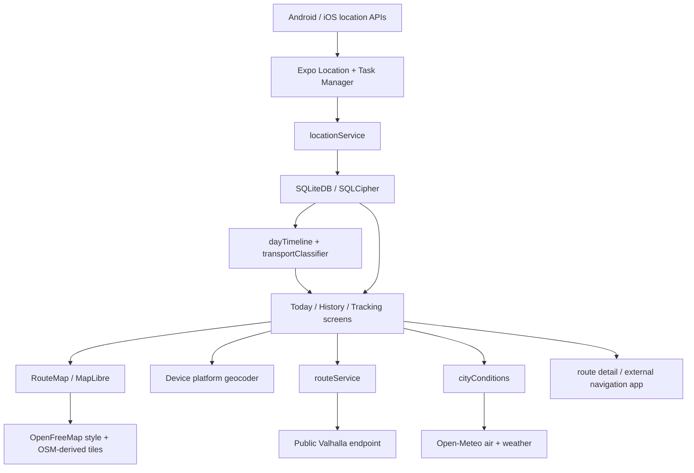
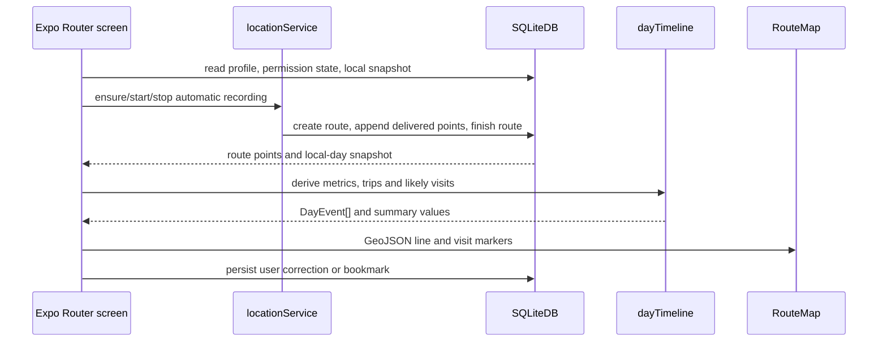

# System Architecture

## Runtime and Boundaries

The existing application under `src/` is TypeScript on Expo SDK 58 / React Native 0.88 / React 19.3, with Expo Router file-based navigation. Native services are reached through Expo modules; Expo-generated `src/android/` and `src/ios/` outputs remain ignored. A separate tracked `native-android/` scaffold was added for the approved MVP: Kotlin, Compose navigation and screen shells exist, but Kotlin compilation was terminated by an external SIGTERM and no APK is confirmed. Room and the native data layer are not implemented. There is no checked-in Swift app or backend.

The app has four practical layers, but not a fully formalized Clean Architecture:

- Screens in `src/app/` own navigation, local UI state, permissions and direct service orchestration.
- UI components in `src/components/` render maps, timeline events, route options, visits and bottom tabs.
- Singleton/domain-like services in `src/services/` perform location lifecycle, SQLite access, provider calls, classification and derived timeline calculations.
- Expo/native and remote boundaries are `expo-location`, `expo-task-manager`, `expo-sqlite`, MapLibre, the device geocoder, OpenFreeMap, Valhalla and Open-Meteo.

Screens call `SQLiteDB` and other services directly. There is no dependency-injection container, repository interface layer, server API or durable cross-screen state store. `screenState.ts` and the current route candidate cache are module-level in-memory state.

## Repository Map

| Path | Responsibility | Current status |
|---|---|---|
| `src/app/_layout.tsx` | Root stack, safe-area provider, reduced-motion configuration; imports location service so its background task is defined | Implemented |
| `src/app/index.tsx` | Today map, local metrics/timeline, recording toggle, city conditions, visit editor | Implemented |
| `src/app/history.tsx` | Local-day calendar, route map, timeline, transport/place edits | Implemented |
| `src/app/tracking.tsx` | Recording status and manual route transport correction | Implemented, secondary entry point |
| `src/app/route-planner.tsx` | Geocoding, disclosure, route search, alternatives, city conditions | Implemented |
| `src/app/route/[id].tsx` | Recorded/planned route detail, bookmarks, external navigation handoff | Implemented |
| `src/app/onboarding.tsx`, `src/app/settings.tsx` | Local profile/foreground permission; recording, background permission, export/delete/settings | Implemented |
| `src/components/RouteMap.tsx` | MapLibre native map, route GeoJSON, markers, weather overlays | Implemented |
| `src/components/DayTimeline.tsx`, `VisitSheet.tsx` | Derived trip/stop timeline and edits | Implemented |
| `src/services/locationService.ts` | Background TaskManager task, foreground watcher and lifecycle serialization | Implemented |
| `src/services/database.ts` | SQLCipher SQLite schema, migration, GPS writes, history, profile, bookmarks, diagnostics | Implemented |
| `src/services/dayTimeline.ts` | Heuristic stop/trip grouping, distance/time/mode aggregation | Implemented |
| `src/services/transportClassifier.ts` | Speed-only three-class majority classifier | Implemented, limited |
| `src/services/routeService.ts`, `routeRecommendation.ts` | Valhalla request/geometry parsing and fastest-only choice | Implemented, limited |
| `src/services/cityConditions.ts` | Open-Meteo air/weather requests, rounding, cache, source/stale metadata | Implemented, area-level only |
| `src/services/mapProvider.ts` | MapLibre style/attribution adapter | Implemented |
| `src/services/diagnostics.ts`, `screenState.ts` | Local diagnostic facade and session-only UI state | Implemented |
| `native-android/` | Separate Kotlin/Compose MVP scaffold and Gradle wrapper | Created in RG-DEV-005; Gradle configuration passes, Kotlin compile/debug APK blocked by external SIGTERM; Room absent |

## Current Component Diagram

## UI-to-Service Flow

## State and Failure Boundaries

- Recording and data writes continue only when the operating system delivers location callbacks. Background permission is required for the background task; a foreground watcher is used as fallback and is not background-equivalent.
- SQLite persists routes and points locally. A write queue serializes GPS append/start/finish operations; not every DB mutation uses that queue.
- Current route candidates live in a module variable and survive only within the running JS process; bookmarks are persisted in SQLite.
- City conditions are cached in memory by rounded coordinate, up to 12 entries, for about 30 minutes. This is not an offline environmental archive.
- A route provider or weather error is surfaced by screen state/diagnostic logging; there is no provider-neutral backend or offline route fallback.

## Android-Specific Reality

There are now two distinct Android paths. `src/` is the current Expo application whose native Android output is generated under ignored `src/android/`. `native-android/` is a separate approved Kotlin/Compose scaffold with its own Gradle wrapper and package ID. Its configuration task succeeded, but `:app:compileDebugKotlin` and `assembleDebug` were terminated by an external SIGTERM (exit 143); no compiler source error, OOM or APK was observed. The SIGTERM sender/reason is unknown. Do not claim native app execution until a compile and APK build succeed. Pixel 9, Compose UI, permissions, Room, migration and runtime behavior remain unverified.

## Architecture Constraints

Keep MapLibre behind `RouteMap` / `mapProvider`; keep provider access behind service functions. Add route/environment contracts at those boundaries and use existing local data flows. Do not introduce a server, graph database, Room, GIS extension or broad use-case layer until a concrete requirement and migration plan justify it.
