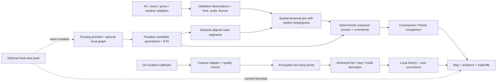
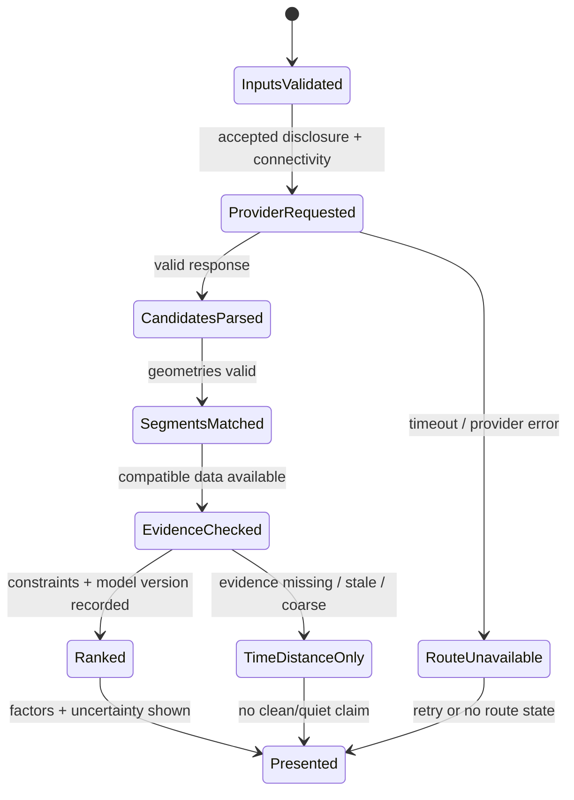

# Target Architecture and Roadmap

## Design Goal

Deliver the owner-approved Kazan MVP as an Android-native Kotlin/Jetpack Compose application using Room, OSM-based maps/geodata, weather and air-quality sources, route segmentation and an explainable Exposure Score. The current checked-in Expo/React Native app remains the verified baseline, not the target implementation. Treat the native effort as a controlled transition with explicit local-history migration and no deletion of the existing app/data until the owner approves the transition.

## Target Components

1. **Native app shell:** Kotlin Android application, Compose navigation and lifecycle-aware UI. Keep the existing Expo app identifiable as legacy/current implementation until native acceptance and migration are proven.
2. **Location capture:** Android location APIs and a user-visible foreground service for active trips; persist timestamp, coordinate, accuracy and source. No uninterrupted-history or battery guarantee.
3. **Local data:** Room entities/DAOs for trips, track points, segments and environmental samples. Room alone does not encrypt; select an encryption/key strategy and prove compatibility with the current SQLCipher history before migration.
4. **OSM map/GIS:** native MapLibre rendering with OSM attribution; OSM roads, green areas and mapped industrial context are features/proxies, not environmental measurements. Bounded Overpass use or prepared data, not broad per-fix queries.
5. **Activity/segments:** limited walking/running/motorized classification with confidence/unknown and manual correction. Distinguish car from bus only if system signals or transit data validate it; no custom ML.
6. **Routing:** compare Valhalla and OSRM for Kazan, required profiles and Russian reachability. Keep candidate generation separate from environmental ranking; routing is the last product feature stage.
7. **Weather/air providers:** Open-Meteo and CAMS are candidates, not yet validated for Kazan/Russia access, terms or sufficient spatial-temporal support. Cache/throttle requests and preserve provenance.
8. **GIS context:** join route segments to supported OSM roads, parks/green areas and mapped industrial data with coverage flags; missing tags remain unknown.
9. **Exposure model:** deterministic, versioned 0–100 route score plus a separate evidence-coverage percentage. Score direction and formula require approval; coverage percentage is not statistical probability.
10. **Screens:** Home map/start, Active route, Analysis, History. Use provided screenshots as visual direction only; sample metrics, AQI, locations and third-party layouts are not product data or exact specifications.

## Future Data Flow

## Route Candidate Lifecycle

## Incremental Migration

- The selected MVP target is native Kotlin/Compose; this supersedes the earlier proposal to keep Expo as the implementation baseline.
- First establish whether existing Expo trips must migrate to the native app, whether the same application ID/signing identity can be retained, and how the SQLCipher key can be accessed safely. Do not overwrite or delete legacy data.
- Use a tracked native Android project path that does not collide with Expo-generated `src/android/`. Keep the old app/build usable until native MVP acceptance; define the retirement point explicitly.
- Introduce Room with an encryption approach only after a migration proof on a copy of the current encrypted DB. Preserve raw points and user corrections separately from derived segments and environmental samples.
- Keep provider adapters typed, cancellable and cache/rate-limit aware. Do not query Overpass once per GPS point or embed privileged API keys in the mobile client.
- Implement route recording → local save → environmental segment analysis → explained result before route alternatives.
- Add the route engine only after the sampled environmental model works for the selected mode. Use the same scoring service for the recorded route and generated alternatives.
- The user requested final MVP acceptance testing after feature completion. Add focused tests with implementation slices, but reserve the full regression, UI/device and Pixel 9 acceptance gate for RG-DEV-014.

## Approved Kazan MVP Delivery Plan

This is the authoritative implementation sequence for the owner-approved MVP in [Product and Requirements](./PRODUCT_AND_REQUIREMENTS.md). It supersedes the generic T0–T6 proposal below. The target is Kotlin/Compose/Room for Kazan, Tatarstan, Russia; the current Expo application is legacy/current implementation and is not evidence that native MVP work is complete.

### Decision Gate T0 — Analyst and Product Owner (not a Developer ticket)

Complete before RG-DEV-005:

- Verify Open-Meteo weather/air, CAMS access, OSM/Overpass, basemap and Valhalla/OSRM coverage/terms/reachability for Kazan and from the target Russian network. Record date, request outcome, source resolution, license, attribution, quotas and fallback. Cloud-container reachability is not proof of availability in Russia.
- Select how weather/air values are collected and aligned to movement time: bounded live sampling, a permitted historical/reanalysis source, or another documented method. Set request cadence/cache so GPS fixes do not become API calls.
- Define Exposure Score direction and normalization; decide whether higher means more favorable or more exposure. Define the confidence/coverage percentage as data completeness/freshness, not a probability.
- Establish whether a no-custom-ML system can distinguish walking/running/car/bus for Kazan. Android activity recognition may report “in vehicle” without identifying car versus bus; consider verified GTFS/transit matching or require an explicit unknown/manual state.
- Decide if legacy Expo history must migrate, whether same application ID/signing continuity is required, and how SQLCipher key material and backups are handled. Do not lose existing local history.
- Approve the exact route profiles for MVP, including whether bicycle is in or out of scope. The current MVP scope lists walking, running, car and bus, not bicycle.

**Exit:** a decision record and source matrix are accepted. If a data source or activity requirement fails feasibility, return that item to the owner before implementation rather than faking data or certainty.

## Developer Tasks

Each ticket is assigned and completed one at a time. Add focused tests with implementation slices; the full regression/UI/device acceptance run occurs at RG-DEV-014 after all MVP features are integrated.

### RG-DEV-005 — Native Android foundation and Compose shell

**Status (2026-11-03): BLOCKED, not accepted.** RG-DEV-005 created the separate `native-android/` scaffold, four Compose screen shells, navigation test source and build instructions. Gradle configuration (`tasks`) passed. RG-DEV-005-R1 confirmed that `:app:compileDebugKotlin` and `assembleDebug` were terminated by external SIGTERM (`SI_USER`, exit 143); no Kotlin compiler diagnostic, `OutOfMemoryError` or cgroup OOM was reported. The sender/reason is unknown. APK was not created; Compose tests and app launch were not run. SDK XML warning (XML 4 vs supported through 3) occurs before tasks and is not the observed cause.

- **Goal/problem:** establish the approved Kotlin/Compose application path; current repo only contains Expo/React Native and generated ignored Android output.
- **Architecture:** create a tracked native app module/path that does not collide with Expo-generated `src/android/`; retain the old app during transition. Keep application ID/signing decisions consistent with T0.
- **Components:** Gradle Kotlin project, Compose, navigation shell for Home / Active / Analysis / History, app manifest and minimal dependency wiring.
- **Depends on:** T0 native ownership, package ID and signing decision.
- **Risks:** parallel app duplication, Android SDK/Gradle mismatch, inability to upgrade/install over current app, accidental edits to generated Expo files.
- **Complete when:** clean local Android debug build installs on Pixel 9; Compose navigation opens all four empty/loading-safe screen shells; current Expo source and local data remain untouched.
- **Complete when:** `:app:compileDebugKotlin` and `assembleDebug` both succeed, APK exists at the documented path, and Compose navigation/state tests run. Manual Pixel 9 installation/acceptance is deferred to RG-DEV-014. Expo source and data remain untouched.
- **Tests:** Kotlin compile, debug APK assembly and native navigation/state test source; no Pixel 9 or full MVP acceptance yet.
- **Subtasks:** T5-1 scaffold (done per report); T5-2 navigation shell/test source (written, execution unconfirmed); T5-3 resolve external termination and build the APK.
- **Retry prerequisite:** use a stable Codespace executor that does not terminate the daemon during compile and ensure 2–3 GB free RAM before starting Gradle. Capture daemon/process logs; do not alter source/toolchain unless fresh evidence identifies a code or compatibility defect.
- **RG-DEV-005-R1:** investigated; confirmed external SIGTERM, but root sender/policy is outside the visible Codespace. No source changes and no APK. Keep the ticket blocked until a successful compile/build.

### RG-DEV-006 — Room data model, encryption and legacy-data plan

- **Goal/problem:** persist trips and samples natively without losing sensitive location history; current storage is Expo SQLite + SQLCipher.
- **Architecture:** Room entities/DAOs for route/trip, point, segment, environmental sample and settings. Select a Room-compatible encryption/key strategy; Room alone is not encryption. Implement import/migration only as authorized by T0.
- **Components:** Room schema/migrations, repository boundary, key storage, migration/import utility and test fixtures derived from a safe copy of the old schema.
- **Depends on:** RG-DEV-005 and T0 legacy-data/key decision.
- **Risks:** SQLCipher/Room compatibility, key alias inaccessible after app replacement, backup mismatch, destructive migration and location-data loss.
- **Complete when:** transactions and schema upgrades are repeatable; prior user data is preserved/imported or the owner has explicitly approved a fresh-start policy; deletion/export semantics are documented.
- **Tests:** DAO/repository tests, migration tests from representative old database/export, key-loss and failed-migration safety tests. Never test migration on the only copy of user data.
- **Subtasks:** T6-1 schema; T6-2 encryption/key lifecycle; T6-3 approved migration path.

### RG-DEV-007 — OSM map and GPS recording lifecycle

- **Goal/problem:** provide the map and active-trip recording in the selected native stack; current MapLibre map and Expo location task are React Native implementations.
- **Architecture:** native MapLibre rendering with OSM attribution and a source/style selected for Kazan; Android location capture with foreground-service lifecycle and explicit permission states. Persist delivered fixes through the repository from RG-DEV-006.
- **Components:** map surface, location adapter/service, permission flow, start/pause/stop controls, active-trip screen, route geometry rendering.
- **Depends on:** RG-DEV-005 and RG-DEV-006; map/provider choice from T0.
- **Risks:** tile-service policy/availability, Android background limits, exact-location privacy, battery impact, duplicate/out-of-order callbacks.
- **Complete when:** user can see current position when authorized, start/stop a trip, see the recorded line update, and receive truthful permission/GPS/service state without network dependence for saving points.
- **Tests:** focused permission/lifecycle and point-persistence tests; final OS/Pixel validation is RG-DEV-014.
- **Subtasks:** T7-1 map/attribution; T7-2 permission/service lifecycle; T7-3 active route rendering and local point writes.

### RG-DEV-008 — Trip history, segmentation and limited activity labels

- **Goal/problem:** turn recorded points into completed trips, time/activity segments and a usable history; current segments/stops are display-time TypeScript heuristics.
- **Architecture:** deterministic segmenter with versioned thresholds and raw points preserved. Support walking/running/motorized/unknown and manual correction; distinguish car/bus only through the T0-validated signal or transit data. No custom ML.
- **Components:** segment model/Room migration, trip finalization, activity source adapter or rules, correction UI, history list/detail map.
- **Depends on:** RG-DEV-006 and RG-DEV-007; activity feasibility from T0.
- **Risks:** speed-only false positives, bus/car ambiguity, time-zone boundaries, gaps and unvalidated confidence values.
- **Complete when:** completed trips reopen with correct ordered points, segments and times; unknown activity remains allowed; manual correction survives reload; gaps are not drawn as observed travel.
- **Tests:** deterministic segmentation boundaries, timestamp ordering/time zones, missing/low-accuracy fixes, manual override precedence and DAO persistence.
- **Subtasks:** T8-1 trip lifecycle; T8-2 segment/activity mapping; T8-3 History list and detail.

### RG-DEV-009 — Weather and air-quality acquisition for trip time

- **Goal/problem:** current app shows only area-level PM2.5/weather and does not retain historical, segment-aligned environmental values.
- **Architecture:** use only T0-approved free/open sources. Create typed provider adapters with units, source, retrieval/valid time, spatial support, model version, staleness and missing state. Throttle/batch/cancel requests; do not call providers for every GPS fix.
- **Components:** Kotlin provider clients/repositories, cache policy, Room environmental sample model, weather and pollutant UI data contract.
- **Depends on:** T0 provider/collection decision, RG-DEV-006, RG-DEV-007.
- **Risks:** Russia endpoint availability, non-commercial terms, source resolution too coarse for route claims, API quotas, historical archive gaps and partial failures.
- **Complete when:** supported Kazan values are acquired and attached to appropriate trip time/segments with provenance; unavailable or stale fields remain explicit; no value is invented or treated as zero.
- **Tests:** parser/unit/time tests, stale/partial/timeout/offline fixtures, cache cadence and source-coverage tests.
- **Subtasks:** T9-1 weather fields; T9-2 pollutant fields available from chosen source; T9-3 temporal sampling/cache/provenance.

### RG-DEV-010 — OSM spatial context for roads, industry and green areas

- **Goal/problem:** environmental comparison needs route-context features; OSM tags are incomplete proxies and are not measurements.
- **Architecture:** use a bounded, license-compliant OSM data strategy for Kazan. Inspect tag coverage before deriving major-road proximity, mapped industrial land/facilities and parks/green areas. Do not issue broad Overpass requests per point.
- **Components:** OSM/Overpass or prepared-extract adapter, spatial matching to trip segments, attribution/source metadata and cache/storage where needed.
- **Depends on:** T0 Kazan data/access decision, RG-DEV-006, RG-DEV-008.
- **Risks:** missing tags, public Overpass rate limits, ODbL attribution, stale extracts and implying dB/air/canopy values from map tags.
- **Complete when:** segment context is reproducible and tagged by source/date/resolution; unsupported features are reported unknown; UI copy calls these road/green/industrial proxies.
- **Tests:** coordinate-order/spatial-boundary fixtures, missing-tag behavior, attribution and stale-data tests.
- **Subtasks:** T10-1 city data coverage audit; T10-2 segment joins; T10-3 data freshness and missingness.

### RG-DEV-011 — Exposure Score and evidence coverage

- **Goal/problem:** the requested 0–100 route result and confidence percentage do not exist; arbitrary weights or a single AQI could mislead users.
- **Architecture:** implement a deterministic, versioned pure scoring model using only approved inputs. Keep environmental exposure and route favorability semantics explicit. Confidence percentage reflects evidence coverage/completeness/freshness, not statistical probability. Missing factors do not become zero.
- **Components:** pure Kotlin scoring module, factor breakdown/provenance types, thresholds and score version persisted with the trip.
- **Depends on:** T0 score decision, RG-DEV-008, RG-DEV-009 and RG-DEV-010.
- **Risks:** modelled air resolution, inconsistent pollutant scales, temperature/weather double-counting, unsupported industrial/green proxies and false precision.
- **Complete when:** identical inputs yield identical score/version/explanation; incomplete evidence lowers coverage and visibly limits conclusions; validation fixtures represent Kazan coverage; no medical-dose claim.
- **Tests:** unit conversion, time-weighted segment cases, normalization boundaries, missing/stale inputs, score direction and deterministic replay.
- **Subtasks:** T11-1 approve score contract; T11-2 factor aggregation; T11-3 coverage percentage and explanations.

### RG-DEV-012 — Compose Analysis and History screens

- **Goal/problem:** deliver the two result surfaces in the MVP and match the actual user flow rather than importing unrelated screenshot features.
- **Architecture:** Analysis reads persisted trip segments/scores; History lists completed trips and opens the saved route/result. Use accessible labels, explicit unknown/stale states and no color-only meaning.
- **Components:** Compose Analysis, History list/detail, route map state, factor/source rows, loading/error/empty states.
- **Depends on:** RG-DEV-007, RG-DEV-008, RG-DEV-009, RG-DEV-010 and RG-DEV-011.
- **Risks:** screenshots contain sample locations/values, calories/heart-rate/rating and visual treatments outside MVP; none are verified requirements/data.
- **Complete when:** all four MVP screens work as one user journey; saved results reopen accurately; source, age, coverage, factors and limitations fit the design.
- **Tests:** Compose UI state/navigation tests and accessibility checks; screenshot review is part of RG-DEV-014.
- **Subtasks:** T12-1 Analysis result; T12-2 History list/detail; T12-3 loading/error/empty/accessibility states.

### RG-DEV-013 — Environmental alternative routing (final feature stage)

- **Goal/problem:** current Valhalla integration returns pedestrian/bicycle candidates and ranks only by time; it does not produce an environmental alternative.
- **Architecture:** choose Valhalla or OSRM based on T0-verified Kazan routes, mode support, terms and Russia reachability. Generate feasible alternatives, run the same segment scoring as RG-DEV-011, then explain the time/exposure tradeoff. Unsupported mode/data returns no environmental winner.
- **Components:** native route-provider adapter, candidate cache, route scoring integration, alternative comparison UI and external-map handoff.
- **Depends on:** RG-DEV-009–012 and approved route profiles/transit data.
- **Risks:** public endpoint outages, mode-specific routing gaps, transit timetable availability, privacy of endpoint transmission and alternate route score not comparable to recorded trip.
- **Complete when:** alternatives share endpoints/mode, are ranked by approved evidence, show reasons/coverage/time cost, and preserve neutral behavior when evidence is inadequate.
- **Tests:** provider parsing, out-of-order requests, candidate constraints, same-model score comparison, missing data and route-profile handling.
- **Subtasks:** T13-1 route-engine Kazan proof; T13-2 alternatives; T13-3 environmental comparison and handoff.

### RG-DEV-014 — Full MVP acceptance and Pixel 9 verification

- **Goal/problem:** service mocks cannot establish Android lifecycle, Room/SQLCipher, UI or provider behavior on-device.
- **Architecture:** perform the one full end-to-end acceptance pass after RG-DEV-005–013 are complete; includes the deferred RG-DEV-003 Android baseline/device check. Do not use this as a substitute for focused implementation tests.
- **Components:** clean native build, install/upgrade path, Pixel 9, OSM map, location service, Room/migration, provider access, Analysis/History, alternative route.
- **Depends on:** all previous MVP tickets and T0 approvals.
- **Risks:** Pixel/API level differences, Russian network restrictions, missing data coverage, background policies, data loss and score misinterpretation.
- **Complete when:** all ten product acceptance criteria in [Product and Requirements](./PRODUCT_AND_REQUIREMENTS.md) pass on the target device or have an explicit owner-approved exception; full automated gate is green; privacy/source disclosures are reviewed.
- **Tests:** full Gradle/unit/integration/Compose suite, clean build/install, permissions, record-stop-reopen, weak/no network, environmental partial outage, score explanation, history and alternate route. Record OS/build/network conditions and battery evidence; do not overclaim continuity.
- **Subtasks:** T14-1 automated full gate; T14-2 Pixel 9 end-to-end; T14-3 final Analyst read-only audit and sign-off.

## Developer Ticket Ledger

- **RG-DEV-001:** reported complete; route candidate request-group ownership and stale-response protection.
- **RG-DEV-002:** reported complete; all 13 JavaScript test files included in `npm test` and deterministic test fixes.
- **RG-DEV-003:** deferred; fold Android build/device validation into RG-DEV-014 rather than testing before MVP completion.
- **RG-DEV-004:** current worktree contains bicycle profile selection/request/bookmark support, but no final completion report was provided and external map handoff still uses walking mode. Bicycle is not in the newly approved MVP activity list; treat this as legacy/out-of-scope unless owner adds it back.
- **RG-DEV-005:** native scaffold created; blocked at Kotlin compile/debug APK by external SIGTERM. Not accepted.
- **RG-DEV-005-R1:** investigated the failure; confirmed external SIGTERM but could not identify sender. No source edits; blocker remains.
- **RG-DEV-006–014:** not started; RG-DEV-006 depends on RG-DEV-005 build acceptance. Assign one task at a time.

## Superseded Generic Roadmap (historical; do not execute for Kazan MVP)

This plan is ordered by evidence and dependency, not by an assumed Kotlin implementation. Current checked-in code is Expo/React Native; “Android-first” is a product goal, while “existing Kotlin app” is not supported by repository evidence. The decision gate below must settle whether Android is delivered through the current Expo app or a separately approved native strategy. Until then, do not begin a rewrite or add Kotlin/Room/Gradle infrastructure.

### T0 — Confirm Platform, Market and Product Contract

- **Goal:** Make the product and implementation target explicit before committing to provider or platform architecture.
- **Problem/current state:** Product request prioritizes Android/Kotlin; repo is TypeScript/Expo with generated, ignored native folders. Launch city, Russia availability, route modes and environmental claims are undecided.
- **Architecture decision:** Keep Expo as the evidence-based baseline unless a measured requirement establishes a native Kotlin gap; select a pilot market and explicitly assess provider access from the target network.
- **Components:** Product owner, `src/package.json`, `src/app.config.js`, `src/app.json`, `docs/ai/PRODUCT_AND_REQUIREMENTS.md`, `EXTERNAL_DATA_SOURCES.md`.
- **Dependencies:** None; decision gate for T3 onward. T1's bounded TypeScript correctness fix can proceed independently.
- **Risks:** Assuming user intent or API availability; a native rewrite would duplicate a working cross-platform app and require a migration plan.
- **Completion criteria:** Written decision for platform, pilot market/city, first transport mode, offline need, privacy/retention, and acceptable environmental claim; no unsupported provider assumed available in Russia.
- **Tests/evidence:** Repository inventory; provider terms/coverage review; hands-on requests from a target-country network or a clearly documented test proxy. Cloud-container success is not Russia-availability evidence.
- **Subtasks:** T0-1 platform decision; T0-2 pilot-market and provider-access decision; T0-3 route-mode and privacy/product-scope decision.

### T1 — Correct Planned-Route Ownership

- **Goal:** Make route comparison and detail labels correspond to the actual alternative group and latest search.
- **Problem/current state:** `getRouteCandidateGroupById()` returns only the matching candidate; late responses can overwrite or clear the in-memory group. Detail can consequently label a non-fastest route as fastest.
- **Architecture decision:** Give each search an explicit group/request identity; only the active request may publish or clear active state. A saved standalone route must not be called fastest without its full comparison group.
- **Components:** `src/services/routeService.ts`, `src/app/route/[id].tsx`, focused route-service tests; touch planner only if the service contract requires it.
- **Dependencies:** None. This is the first proposed Developer task, `RG-DEV-001`, specified in [Agent workflow](./AGENT_WORKFLOW.md).
- **Risks:** Existing in-memory candidate consumers, saved bookmarks and route-detail lifecycle may rely on current module state.
- **Completion criteria:** Group lookup is correct; stale requests cannot mutate current candidates; saved singletons are labeled neutrally; current UI/provider payload remains compatible.
- **Tests:** Deferred-promise tests for old/new success and failure order; group membership; saved-route detail; correct fastest designation.
- **Subtasks:** T1-1 candidate group identity and stale-response guard (one Developer ticket); T1-2 verify planner/detail contract and regression coverage in the same focused slice.

### T2 — Make the Test Gate Trustworthy

- **Goal:** Ensure maintained tests are discoverable, deterministic and agree with the intended service error contract.
- **Problem/current state:** `npm test` passes 81 tests but omits five service tests; three `stop-recording` assertions fail and a wildcard test run stalled in race tests.
- **Architecture decision:** Keep Node's existing test runner; do not add a framework. Decide whether failures propagate (current behavior) or are swallowed before changing assertions. Isolate race fixtures and bound execution time.
- **Components:** `src/package.json`, maintained `src/services/*.test.cjs`, `docs/ai/UI_UX_AND_TESTING.md`.
- **Dependencies:** T1 results inform route race coverage; no product/platform decision required.
- **Risks:** Updating test commands can surface unrelated legacy failures; changing production behavior to satisfy stale tests is out of scope without an explicit decision.
- **Completion criteria:** Every maintained suite is individually runnable and included or explicitly excluded with a reason; no unbounded/hanging test; standard commands have documented results.
- **Tests:** Standard suite, race tests in isolation, stop behavior, route service concurrency and typecheck.
- **Subtasks:** T2-1 agree error contract; T2-2 repair/retire stale tests; T2-3 connect deterministic suites to scripts.

### T3 — Select and Validate Pilot Environmental Evidence

- **Goal:** Find one realistic environmental factor with adequate geography, freshness, license and privacy for the selected pilot.
- **Problem/current state:** Open-Meteo supplies area-level modelled PM2.5/weather; it does not support street ranking. Noise/traffic/green layers are not integrated. Russia access and city coverage are unverified.
- **Architecture decision:** Start with one factor and one city; prefer official/open data with documented resolution. Keep route ranking time/distance-only until evidence passes validation.
- **Components:** `docs/ai/EXTERNAL_DATA_SOURCES.md`, a pilot-source evidence matrix, `src/services/cityConditions.ts` and `routeService.ts` as constraints only.
- **Dependencies:** T0. May proceed as analyst research; does not need a production-code change.
- **Risks:** Open data may be coarse, delayed, non-commercial, geographically incomplete or unreachable from the target network.
- **Completion criteria:** Sample payload/data, coverage map, spatial and temporal resolution, unit/method, license, attribution, quotas, key requirements, Russia reachability test and explicit out-of-coverage behavior are recorded.
- **Tests/evidence:** Parse representative fixtures; compare time/coverage to local reference monitors or authoritative map metadata; document reproducible network check and its location.
- **Subtasks:** T3-1 compare candidate datasets; T3-2 validate selected source against local evidence; T3-3 approve or explicitly defer the factor.

### T4 — Define Exposure Data Contract and Offline-Safe Calculation

- **Goal:** Prototype a deterministic segment-level exposure proxy that cannot turn missing data into a clean-route claim.
- **Problem/current state:** No environmental observation, route segment join, historical time alignment or score model exists in storage.
- **Architecture decision:** Keep raw GPS separate from derived segments and environmental observations; store provenance, support geometry, valid/retrieved time, model version, uncertainty and missing/stale state. Do not persist a score until product need and migration are agreed.
- **Components:** Proposed pure domain module and provider adapter; `cityConditions.ts`; optional SQLite migration only after data lifecycle is approved.
- **Dependencies:** T0 and T3; T2's focused test conventions.
- **Risks:** False precision from grid interpolation, incompatible units, incorrect coordinate order, migration/data growth and non-reproducible model changes.
- **Completion criteria:** Fixture-backed prototype is deterministic, units/time are explicit, unknown/stale data remain unknown, and output is withheld when source scale or uncertainty cannot support route comparison.
- **Tests:** GeoJSON coordinate order, unit/time conversion, partial/stale/offline inputs, segment duration, reproducibility, migration if applicable, held-out pilot comparison.
- **Subtasks:** T4-1 data contract; T4-2 pure spatial-temporal join/proxy; T4-3 analyst validation review before UI claims.

### T5 — Present Evidence and Tradeoffs in Route UX

- **Goal:** Show what the selected route optimizes and why, with confidence and unavailable factors.
- **Problem/current state:** UI presents real pedestrian candidates and fastest-only choice; no environmental route score or verified quiet route exists. Figma's quiet-route metrics are illustrative.
- **Architecture decision:** Keep current Expo navigation and MapLibre UI. Add only factors accepted by T3/T4; use neutral states when evidence is unavailable. Do not implement turn-by-turn guidance as part of comparison UI.
- **Components:** `src/app/route-planner.tsx`, `src/app/route/[id].tsx`, `RouteOptionCard.tsx`, `RouteMap.tsx`, accessibility and privacy copy.
- **Dependencies:** T1, T3 and T4; Figma target states require product review.
- **Risks:** Demo numbers leaking into production, misleading color-only semantics, stale provider results and screen mismatch with approved route model.
- **Completion criteria:** Baseline and candidates use equal endpoints/mode; time/distance and supported factor breakdown are clear; sources, freshness, unknowns and non-medical disclaimer are accessible.
- **Tests:** UI state tests for loading/empty/stale/no-data/error, route group selection and source detail; screenshot/device review on supported viewport.
- **Subtasks:** T5-1 evidence explanation; T5-2 compare/detail states; T5-3 accessibility and visual acceptance.

### T6 — Android Reliability, Battery and Offline Readiness

- **Goal:** Validate the selected Android delivery path on the stated Pixel 9 target without reopening already-covered GPS algorithm work absent a measured issue.
- **Problem/current state:** Expo config requests background location/foreground service, but no generated Android build or device test is evidenced. No offline graph/tile package exists.
- **Architecture decision:** If Expo remains selected, test generated native output and keep config in Expo plugins; if a native Kotlin gap is proven, scope a separate approved module/ADR. Do not promise uninterrupted recording or battery percentages.
- **Components:** Expo prebuild output, permission/service configuration, SQLCipher native build and device validation; optional offline packs only after product decision.
- **Dependencies:** T0, and a stable capture implementation; does not block the exposure prototype's synthetic tests.
- **Risks:** OS/OEM background restrictions, manifest drift, backup/key behavior, network/provider blocking, battery cost and store policy.
- **Completion criteria:** One documented Pixel 9/Android version matrix covers permission grant/denial/revocation, background/foreground, process recreation, Doze, poor signal, SQLCipher migration and provider failure; no broad reliability claim beyond evidence.
- **Tests:** Real-device scripted checks, generated manifest/build inspection, local data integrity, bounded battery measurement; offline tests only for features actually implemented.
- **Subtasks:** T6-1 reproducible Android prebuild; T6-2 one focused device pass; T6-3 decide whether evidence justifies a native Kotlin module or offline work.

## Archived Ticket Reference

RG-DEV-001 and RG-DEV-002 are reported complete. RG-DEV-003 is deferred into final device acceptance RG-DEV-014. RG-DEV-004 has partial bicycle-profile changes in the current worktree but bicycle is outside the owner-approved Kazan MVP scope unless explicitly added back. The next MVP ticket is RG-DEV-005 only after the T0 source, score, activity and migration gates are accepted. See the [Developer ticket ledger](#developer-ticket-ledger) and [Agent workflow](./AGENT_WORKFLOW.md).
